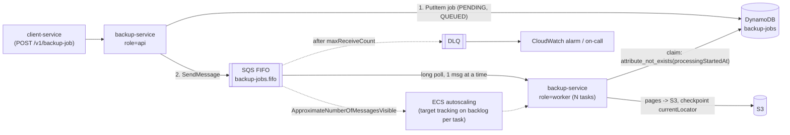

# ADR 0001 — Move backup/archival execution to SQS-fed worker tasks

| | |
|---|---|
| **Status** | Proposed |
| **Date** | 2026-11-10 |
| **Scope** | `backup-service`, `client-service` (trigger side only), ECS/infra |
| **Supersedes** | In-memory `jobSlots` / `pageSlots` as the *only* line of defence (they stay as the per-worker guard) |

---

## 1. Context

`backup-service` is one ECS container that does two unrelated things:

1. serves the internal HTTP API (`/v1/backup-job`, `/v1/restore`, `/v1/realtime-backup`, `/v1/glue`), and
2. runs long Salesforce backup/archival jobs **inside the same Node process**, started fire-and-forget from the controller (`runBackupJob(...).catch(() => {})`).

In production the task died with `FATAL ERROR: Ineffective mark-compacts near heap limit` after ~12.8 h uptime, with a ~4 GB heap that could not be collected. The cause was unbounded concurrency: each job exports 6 objects in parallel, each page is up to 50k rows held in memory several times over, and nothing capped how many jobs ran at once.

The interim fix (branch `bug/restore`) added a per-process semaphore (`MAX_CONCURRENT_JOBS=2`, `MAX_CONCURRENT_PAGES=2`) and smaller pages. That stops the crash, but it has structural limits:

| Limit of the in-memory queue | Consequence |
|---|---|
| Queue lives in process memory | Deploy / crash / scale-in drops every waiting job; they stay `PENDING` until someone calls resume |
| Per-container only | N tasks = N independent queues; no global view or fairness |
| API and workers share a process | A heavy job degrades the HTTP API; an OOM kills the API *and* every in-flight job |
| No queued state / visibility | A job waiting for hours looks identical to a stuck one |
| No scaling signal | Cannot autoscale on backlog; only on CPU/memory, which lags |
| Stale sweeper disabled (`// startStaleJobSweeper()` in `src/index.ts`) and no SIGTERM handler exists | Orphaned jobs are never auto-failed; shutdown does not mark active jobs |

## 2. Decision

Split **intake** from **execution** with an SQS queue:

- The `backup-service` API (renamed conceptually *api* role) only validates, creates the job record, **enqueues a message**, and returns `201`. It never runs a job.
- A new ECS service (*worker* role, same image, different start command) long-polls the queue and executes jobs using the existing `executeBackupJob` / `executeArchivalJob` code.
- The per-process semaphores are kept **inside each worker** as the memory guard.

Same codebase and Docker image; the role is chosen by an env var (`SERVICE_ROLE=api|worker`). No new repo, no new language.

## 3. Target flow



### 3.1 Queue

- **SQS FIFO**, `MessageGroupId = crmId` (the Salesforce org), `MessageDeduplicationId = backupJobId`.
  - Group id serialises jobs for the *same* org (protects that org's Salesforce API quota and avoids two bulk exports against the same org) while different orgs run in parallel.
  - Dedup id makes a retried HTTP trigger from `client-service` idempotent for 5 minutes.
- Separate queue for archival if its priority/limits need to differ; start with one queue and a `type` field.
- **DLQ** with `maxReceiveCount = 3`; alarm on `ApproximateNumberOfMessagesVisible > 0`.

### 3.2 Message

```json
{
  "version": 1,
  "type": "BACKUP | ARCHIVAL",
  "backupJobId": "…",
  "backupConfigId": "…",
  "crmId": "…",
  "executionType": "NEW | RETRY",
  "triggerSource": { "name": "…", "entityId": "…" }
}
```

Only identifiers go on the queue (SQS limit is 256 KB). Credentials are **not** put in the message: the worker re-reads the job from DynamoDB, which already holds the encrypted `source` / `destination`. This also means a message never contains secrets in queue logs or the DLQ.

### 3.3 Worker behaviour

1. Receive one message (`MaxNumberOfMessages=1`, `WaitTimeSeconds=20`). A worker task runs at most `MAX_CONCURRENT_JOBS` messages (default 1–2).
2. Load the job; call the existing `executeBackupJob`. The conditional write on `processingStartedAt` remains the **idempotency lock**, so a duplicate delivery gets `ConditionalCheckFailed` → ack and drop.
3. **Visibility timeout heartbeat.** Jobs run for hours (poll window alone is up to 2 h). A fixed timeout would cause a second worker to receive the same message mid-run. The worker calls `ChangeMessageVisibility` every ~60 s (extend by 5 min) while the job runs. SQS caps a single message at 12 h of total visibility, so the heartbeat must stop and the job must checkpoint/yield before that (see 3.5).
4. On success **or handled failure** (job already marked `FAILED`/`PARTIAL_FAILURE` in DynamoDB): `DeleteMessage`. Failure is data in DynamoDB, not a reason to redeliver.
5. On process death (OOM, SIGKILL, scale-in): the heartbeat stops, the message becomes visible again after ≤ 5 min, another worker picks it up and calls the **existing resume path** (`executionType: RETRY`), which continues from `currentLocator`. This is the key property the in-memory queue cannot give.
6. **SIGTERM handler** (needed today regardless): stop polling, finish or checkpoint the current page, let the message become visible again, exit within ECS `stopTimeout`.

### 3.4 Job states

Add an explicit `QUEUED` state (or a `queuedAt` field) so the UI/ops can tell "waiting for a worker" from "running" from "stuck". The sweeper's definition of stale stays *claimed (`processingStartedAt`) and not updated for 6 h*, so queue time never counts toward it. Re-enable `startStaleJobSweeper()` in the worker role only.

### 3.5 Jobs longer than the 12 h SQS ceiling

Backups of very large orgs may exceed 12 h. Options, in order of preference: (a) at ~10 h the worker checkpoints, releases the lock and **re-enqueues itself** as a `RETRY` message; (b) raise per-job parallelism of pages, not duration; (c) Step Functions for those jobs only. (a) needs no new service because resume-by-locator already exists.

### 3.6 Autoscaling

ECS target tracking on a custom metric **`visible messages / running worker tasks`** (the standard "backlog per task" pattern), scale-out fast, scale-in slow, `minCapacity=1`. Because memory use per task is bounded by `pageSlots`, task size is predictable and can be right-sized instead of over-provisioned. Scale-in must respect the SIGTERM drain in 3.3.

### 3.7 Fairness and Salesforce limits

FIFO `MessageGroupId=crmId` gives one-job-at-a-time per org. The existing `checkSalesforceApiLimitUsage` stays as the second guard. Per-org priority and per-plan limits are explicitly **out of scope** for this ADR.

## 4. Alternatives considered

| Option | Why not (now) |
|---|---|
| **Keep in-memory semaphore only** | Fixes OOM but not durability, scaling, or API isolation. Retained as the in-worker guard. |
| **ECS `RunTask` per job** | Perfect isolation and per-job memory sizing, but ~30–60 s cold start per job, task-quota management, and harder to bound total cost; a good *later* option for the very largest jobs. |
| **DynamoDB as the queue** (poll `PENDING`) | No new infra, but needs hand-built visibility/lease, backoff, DLQ, and polling load; reimplements SQS badly. |
| **AWS Batch** | Strong fit for long jobs, but a bigger operational shift (job defs, compute envs) than this team needs today. |
| **Bull/BullMQ + Redis** | Adds Redis to operate; SQS is already inside the AWS footprint and IAM model. |
| **Step Functions orchestration** | Overkill for a single-stage pipeline; revisit if jobs gain multi-stage dependencies. |

## 5. Consequences

**Positive** — durable queue (deploy/crash-safe), API isolated from heavy work, autoscaling on real backlog, per-org serialisation, a DLQ for poison jobs, bounded and right-sizeable worker memory, clear `QUEUED` visibility.

**Negative / costs** — two ECS services to deploy and monitor, new IAM permissions (`sqs:SendMessage` for api; `sqs:ReceiveMessage/DeleteMessage/ChangeMessageVisibility` for worker), at-least-once delivery means every step must stay idempotent, extra latency (seconds) between trigger and start.

**Risks and mitigations**

| Risk | Mitigation |
|---|---|
| Duplicate delivery runs a job twice | `processingStartedAt` conditional write (already in place) + FIFO dedup id |
| Heartbeat fails, message redelivered while job still running | Same lock rejects the second worker; heartbeat failures logged and alarmed |
| Resume re-uploads a page already written | Page S3 key = locator, so re-upload overwrites the same key (already how resume works) |
| Poison job crashes workers repeatedly | `maxReceiveCount=3` → DLQ + alarm; job marked `FAILED` by the sweeper |
| Rollout breaks current trigger path | Feature flag (below); API keeps in-process execution until flipped |

## 6. Rollout plan

1. **Prereqs (no queue yet):** add SIGTERM handler; re-enable the sweeper; add `QUEUED` state; metric/log `semaphore.active/waiting`. *Ships independently.*
2. **Infra:** create queue + DLQ + alarms, IAM, worker ECS service (desired count 0), autoscaling policy.
3. **Code:** `SERVICE_ROLE`, enqueue in controllers behind `EXECUTION_MODE=inline|queue` (default `inline` = today's behaviour), worker poll loop reusing `executeBackupJob/ArchivalJob`.
4. **DEV → qa:** flip to `queue`; test crash mid-job (kill worker task) and verify resume from `currentLocator`; test duplicate trigger; test 100-job burst.
5. **Production:** canary one org, then all; keep `inline` as an instant rollback.
6. **Cleanup:** remove inline execution after two stable weeks. Restore jobs follow the same pattern in a later ADR.

## 7. Open questions

- Is a single FIFO queue enough, or do archival and backup need different priorities?
- What is the real p99 job duration? If almost nothing exceeds 10 h, 3.5(a) can be deferred.
- Worker task size: pick after one week of the `pageSlots`-bounded memory metric (start 4 GB / 1 vCPU).
- Should realtime-backup (CDC webhook) also go through a queue? Probably yes, as a separate standard queue, but out of scope here.
- Who owns the DLQ on-call runbook?
