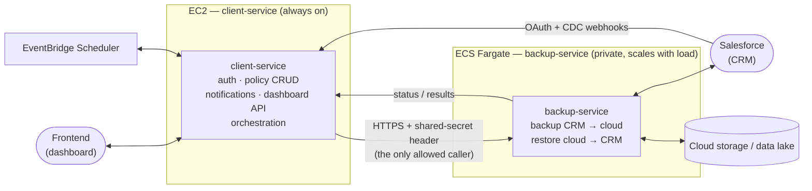

# client-service ↔ backup-service — Roles & Interaction

This document describes what each of the two Node.js services in this platform is responsible for, how they are deployed, and exactly how they talk to each other. It is a working-flow reference, not an exhaustive architecture spec — see [`docs/architecture-graph/ARCHITECTURE.md`](../architecture-graph/ARCHITECTURE.md) for full technical depth (routes, tables, Hudi internals, etc.).

> **Branch note:** the latest QA-tested code for both `client-service` and `backup-service` lives on the **`QA`** branch.

## 1. The two services, in one sentence each

| Service | Role |
|---|---|
| **client-service** | The public-facing brain: frontend API, Salesforce auth, policy/config management, notifications, dashboard, orchestration. |
| **backup-service** | The private worker: moves data — backup from CRM to cloud storage, restore from cloud storage back to CRM. |

Neither service is a superset of the other — they are split by **who they talk to** and **what kind of work they do**, not by feature area.

---

## 2. client-service

### Deployment

* Runs on **EC2**, managed by **PM2**.
* Designed to be **up 24×7** — it is the front door for the frontend, for Salesforce webhooks, and for scheduled triggers. It cannot go idle/scale-to-zero the way a worker can, because something external could reach out to it at any time.

### Who it talks to

* **Frontend** — the dashboard application calls client-service directly (auth, config CRUD, notifications, restore preview, etc.).
* **Salesforce webhooks (CDC)** — Salesforce pushes change-data-capture events here; client-service decrypts/validates the payload and decides what to do with it.
* **EventBridge Scheduler** — client-service creates/updates/deletes schedules for recurring backup configs, and EventBridge calls back into client-service on each cadence to fire the due jobs.
* **backup-service** — client-service is the *only* caller of backup-service. It delegates all actual data-movement work over an internal, secret-authenticated HTTP call.

### What it owns (responsibilities)

* Authentication & RBAC (JWT sessions, role/permission gateway).
* Salesforce OAuth (PKCE) and org connection setup.
* **Policy management** — creating and editing backup configs, archival configs, and restore policies (what to back up, on what cadence, what to restore and how).
* **Notifications & dashboard** — job status, history, and alerts surfaced to the user.
* Scheduling — deciding *when* a backup/archival job is due and asking backup-service to run it.
* Restore-preview (Athena queries) so a user can inspect data before triggering an actual restore.

Put simply: **client-service decides *what* should happen and *when*, and gives the user a place to configure and watch it.**

---

## 3. backup-service

### Deployment

* Runs on **ECS (Fargate)**, as containers.
* **Not a 24×7 always-on service** in the same sense as client-service — it is a scalable worker pool. When load/resource usage on the running tasks exceeds capacity, ECS scales out by launching additional tasks to absorb the extra job volume; when load drops, it scales back in.
* This fits the workload: backup/restore jobs are bursty (triggered by cron, webhook, or manual action) rather than continuous, so a horizontally-scalable container fleet is a better fit than a single long-lived process.

### Who it talks to

* **client-service only.** backup-service is **fully private** — it has no route that the frontend, Salesforce, or any other external caller can reach directly. Every request into backup-service must come from client-service and carry the internal shared-secret header; requests without it are rejected.
* **Salesforce** — but only as a downstream call it makes itself (Bulk API extraction, Bulk API ingest for restore), never as an inbound caller.
* **Cloud storage (S3 / data lake)** — reads and writes raw backup data, and (indirectly, via the Glue catalog it registers) makes that data queryable.

### What it owns (responsibilities)

* **Backup**: pull data out of the CRM (Salesforce) via the Bulk API / CDC payload handed to it, classify it (insert/update/delete), and land it in cloud storage.
* **Restore**: take the reconstructed record set (built from the cloud-side data) and push it back into the CRM via the Bulk API.
* Archival: backup a record set, then purge it from the live CRM org.
* Job execution bookkeeping — job status, retries, stale-job cleanup — for the jobs it runs.

Put simply: **backup-service is the pipe between the CRM and the cloud** — data in, data out — and does no user-facing or policy work of its own.

---

## 4. How they interact

### Trigger → result, in words

1. Something decides a backup/restore is due: a **schedule** (EventBridge → client-service), a **webhook** (Salesforce CDC → client-service), or a **user action** on the **frontend** (via client-service).
2. client-service resolves the relevant policy (backup config / archival config / restore policy) and calls backup-service over the internal-only HTTPS endpoint, authenticated with the shared secret.
3. backup-service does the actual data movement — extracting from Salesforce and writing to cloud storage (backup), or reading reconstructed data and pushing it into Salesforce (restore) — scaling out on ECS if job volume exceeds current task capacity.
4. backup-service reports job status/results back to client-service.
5. client-service surfaces that result to the user through **notifications** and the **dashboard**.

### Why the split is enforced this way

* **client-service must always be reachable** (frontend, webhooks, scheduler), so it runs on EC2/PM2 as a persistent process.
* **backup-service must never be reachable except by client-service** — it holds no user-facing surface, so keeping it private (internal-auth only, no public routes) reduces attack surface and keeps CRM-data-movement logic isolated from the public API layer.
* **backup-service's workload is bursty**, so ECS's ability to add task capacity on demand (and shrink back down) fits it better than a fixed always-on process — client-service has no equivalent need since its job is to always be listening, not to do heavy variable-volume work itself.
